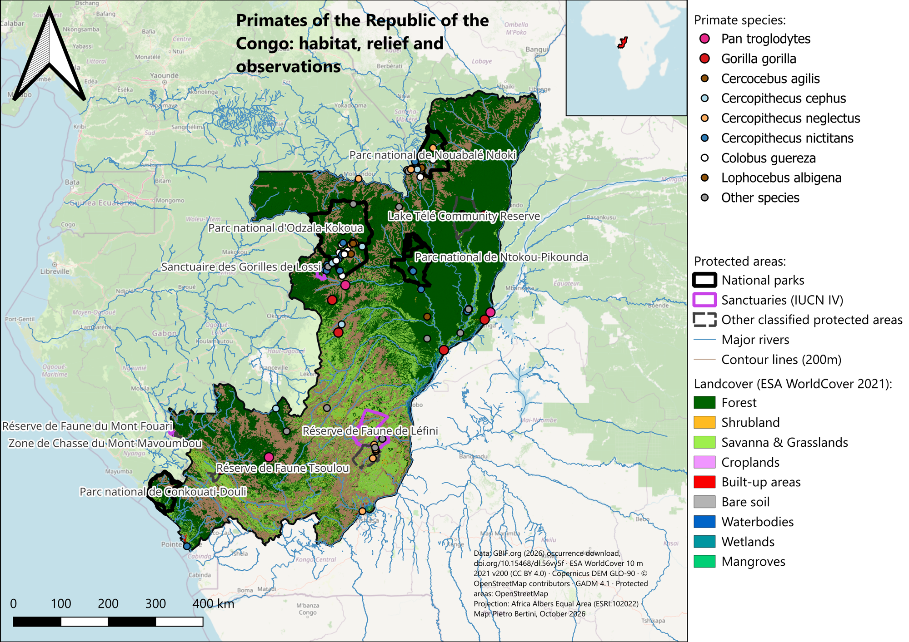
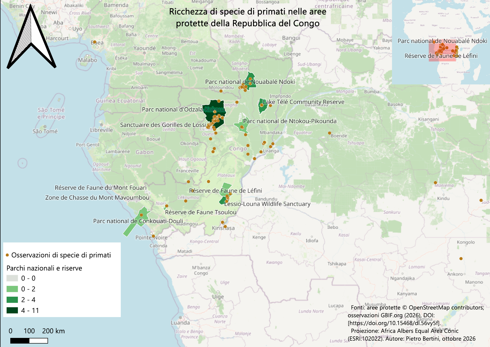

# Primates in the protected areas of the Republic of the Congo

Spatial analysis of primate occurrence records in the **Republic of the Congo**: which protected areas host the most species, and in which habitats, elevations and distances from rivers primates are observed. Built in QGIS.

## Questions

1. Which protected areas have the highest primate species richness?
2. In which land cover types, at which elevations and how close to rivers are primates recorded?

## Data

| Data | Source |
|---|---|
| Primate occurrences (order Primates) | GBIF.org (2026), occurrence download [doi:10.15468/dl.56vy5f](https://doi.org/10.15468/dl.56vy5f) |
| Protected areas | OpenStreetMap (WDPA not available for download) |
| Country boundary | GADM 4.1 |
| Elevation | Copernicus DEM GLO-90 |
| Land cover | ESA WorldCover 2021, 10 m (CC BY 4.0) |
| Rivers | OpenStreetMap |

Projection: **Africa Albers Equal Area (ESRI:102022)**, so that areas and distances are correct.

## Method

1. **Cleaning GBIF records:** kept records with valid coordinates inside the country → **249 observations, 20 species**.
2. **Species richness per protected area:** spatial join of points and polygons, count of distinct species.
3. **Environment of each observation:** elevation sampled from the DEM, land cover class from WorldCover, distance to the nearest major river.
4. **Maps:** a choropleth of species richness and a habitat map with relief (hillshade, 200 m contours), rivers and observations by species.

## Results

- Median elevation of observations: **376 m**; median distance from a major river: **1.2 km**.
- **84 %** of observations fall in forest.
- **Odzala-Kokoua National Park** stands out: **107 observations, 11 species**, 97 % in forest.

### Limitations

GBIF data are opportunistic: richness partly reflects **sampling effort** (where researchers go) and not only true diversity. Results describe recorded observations, not population estimates.

## Tools

QGIS (spatial joins, raster sampling, hillshade, contours, print layouts) · GBIF · ESA WorldCover · Copernicus DEM

---

### 🇮🇹 In breve

Analisi in QGIS delle osservazioni GBIF di primati nella Repubblica del Congo: ricchezza di specie per area protetta e caratteristiche ambientali (habitat, quota, distanza dai fiumi). 249 osservazioni di 20 specie; il Parco nazionale di Odzala-Kokoua ospita 11 specie, l'84 % delle osservazioni è in foresta.

*Author: Pietro Bertini, ecologist – October 2026*
